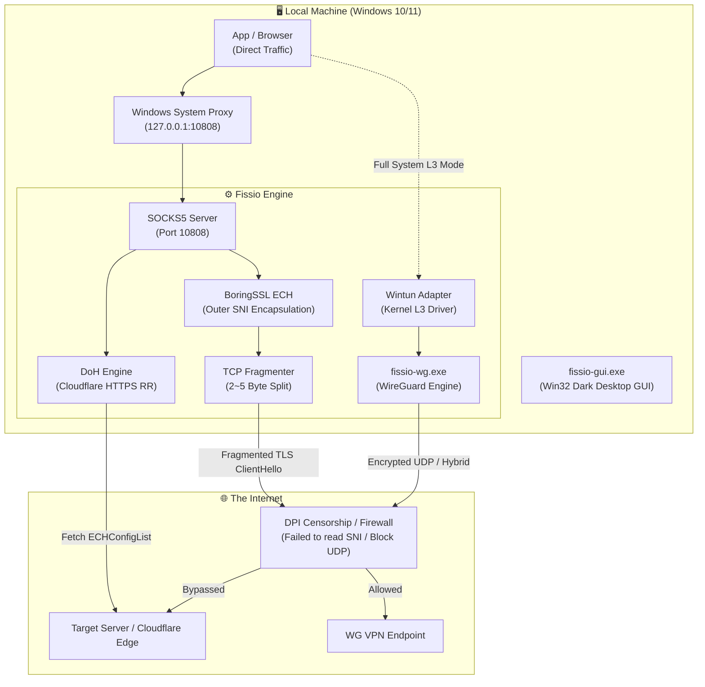

<div align="center">

```text
███████╗██╗███████╗███████╗██╗ ██████╗ 
██╔════╝██║██╔════╝██╔════╝██║██╔═══██╗
█████╗  ██║███████╗███████╗██║██║   ██║
██╔══╝  ██║╚════██║╚════██║██║██║   ██║
██║     ██║███████║███████║██║╚██████╔╝
╚═╝     ╚═╝╚══════╝╚══════╝╚═╝ ╚═════╝ 
```

# FISSIO

**Next-Gen Ultra-Lightweight ECH Proxy & WireGuard®-Compatible L3 VPN Client**  
*초경량 순수 네이티브 ECH 프록시 & WireGuard® 프로토콜 호환 L3 터널 클라이언트*

[-0078D6?style=for-the-badge&logo=windows&logoColor=white)](https://microsoft.com/windows)
[](https://isocpp.org/)
[](https://learn.microsoft.com/windows/win32/)
[]()
[]()
[]()

[English](#-overview-english) • [한국어 설명](#-개요-korean) • [Architecture](#-architecture--mechanisms) • [Key Features](#-key-features) • [Build Guide](#-build--development) • [Legal & Trademark](#-legal--trademark-notice)

---

</div>

## 🌐 Overview (English)

**Fissio** is a high-performance, ultra-lightweight Windows desktop client engineered to bypass sophisticated DPI (Deep Packet Inspection), SNI censorship, and protocol throttling. 

Built in pure **C++20** with **zero bloated frameworks** (No Electron, No Qt, No .NET, No Chromium), Fissio delivers instant launch speeds, consumes less than 15 MB of RAM, and presents a modern dark-mode GUI crafted entirely with native Win32 & Desktop Window Manager (DWM) APIs.

### 🛡️ Core Highlights
- **Encrypted Client Hello (ECH)**: Dynamic DNS-over-HTTPS (DoH) HTTPS RR (Type 65) querying, binary ECHConfigList parsing, and BoringSSL Outer SNI encapsulation.
- **TCP Fragmentation Engine**: Advanced TCP segmentation (2~5 byte initial split + jitter delay) defeating DPI state machines.
- **WireGuard® Protocol L3 Tunnel**: Full-system routing through the official high-speed Wintun kernel driver (`wintun.dll`).
- **Hybrid Bypass Mode**: Couples WireGuard L3 tunneling with ECH fragmentation for environments blocking standard UDP.
- **Pure Win32 Modern Dark GUI**: Seamless border & caption unification (`#18181B`), custom owner-drawn interactive buttons, Windows 11 rounded corners, and native dark controls.
- **Zero-Friction UX**: Drag & drop `.conf` profile import, system tray minimization, auto-start on Windows boot, and one-click emergency network restoration.
- **Automatic 7-Language i18n**: Real-time hot-switching without restart for Korean, English, Simplified Chinese, Japanese, Spanish, Russian, and Arabic.

---

## 🇰🇷 개요 (Korean)

**Fissio**는 강화된 인터넷 검열(SNI 차단, 국가 단위 DPI 패킷 감청, VPN 프로토콜 차단)을 무력화하기 위해 설계된 **C++20 기반 초경량 올인원 네트워크 프록시 & L3 터널 클라이언트**입니다.

Electron이나 .NET 같은 무거운 프레임워크를 일체 배제하고 **순수 Win32 API 및 Windows DWM 하드웨어 렌더링**만으로 제작되어, 실행 파일 크기 1.5MB, 메모리 점유율 15MB 미만의 압도적인 성능을 자랑합니다.

---

## 🌟 Key Features

| 분류 | 기능 설명 | 세부 특징 |
|:---|:---|:---|
| **🛡️ ECH SOCKS5 Proxy** | TLS 1.3 Encrypted Client Hello | Cloudflare DoH Type 65 HTTPS RR 실시간 추출, BoringSSL ECH 주입, 실제 SNI 암호화 |
| **✂️ TCP Fragmentation** | DPI 우회 패킷 미세 조각화 | ClientHello 헤더를 2~5바이트 단위로 분할 전송하여 DPI 장비의 상태 추적 교란 |
| **⚡ WG L3 VPN** | WireGuard® 프로토콜 호환 터널 | 커널 레벨 Wintun 드라이버 연동, 0.0.0.0/1 & 128.0.0.0/1 무단속 전체 가상 어댑터 라우팅 |
| **🧬 Hybrid Mode** | ECH + WG 결합 우회 모드 | UDP 패킷이 차단되는 폐쇄망 환경에서 ECH 조각화와 터널을 복합 적용하여 방화벽 통과 |
| **🎨 Modern Dark GUI** | 100% 네이티브 무결점 다크 테마 | DWMWA_CAPTION_COLOR(`#18181B`) 타이틀바 일체화, 둥근 모서리, 부드러운 애니메이션 버튼 |
| **📂 Drag & Drop** | 설정 파일 드래그 앤 드롭 | 탐색기에서 `.conf` 파일을 창 안으로 끌어다 놓기만 해도 즉시 파싱 및 터널 모드 전환 |
| **🌐 7개 언어 i18n** | 실시간 다국어 지원 | Windows OS 언어 자동 감지 + 한국어, 영어, 중국어, 일본어, 스페인어, 러시아어, 아랍어 실시간 전환 |
| **🧹 Emergency Clean-up** | 원클릭 비상 라우트 복구 | 비정상 종료 시 남은 좀비 프로세스, 트레이 고스트 아이콘, 가상 라우트, 시스템 프록시 일괄 정상화 |
| **🛡️ UAC Manifest** | 관리자 권한 자동 승격 | 가상 어댑터 및 라우팅 테이블 제어를 위해 별도의 '우클릭 관리자 실행' 없이 자동 UAC 요청 |

---

## 📐 Architecture & Mechanisms



---

## 🌍 Supported Languages (i18n)

Fissio checks the system's default UI language via `GetUserDefaultUILanguage()` upon launch and automatically applies the matching interface. If the system language is unsupported, it defaults seamlessly to **English**.

| Language | Code | Native Name | Status |
|:---|:---:|:---|:---:|
| **Korean** | `ko` | 한국어 | ✅ 100% |
| **English** | `en` | English | ✅ 100% (Default Fallback) |
| **Chinese (Simplified)** | `zh` | 简体中文 | ✅ 100% |
| **Japanese** | `ja` | 日本語 | ✅ 100% |
| **Spanish** | `es` | Español | ✅ 100% |
| **Russian** | `ru` | Русский | ✅ 100% |
| **Arabic** | `ar` | العربية | ✅ 100% (RTL Supported) |

---

## 🚀 Quick Start Guide

### 1. Download & Run
1. Go to the [Releases](https://github.com) section and download the latest zip archive.
2. Extract the folder anywhere (e.g. `C:\Tools\Fissio` or `D:\Fissio`).
3. Run **`fissio-gui.exe`** (or create a desktop shortcut via `scripts\create_shortcut.ps1`).

### 2. Choose Mode
- **SOCKS5 ECH Proxy Mode (Default)**:
  - Check **"Auto-configure Windows System Proxy"**.
  - Click the large **`[ START SERVICE ]`** button.
  - All web traffic from Chrome, Edge, Brave, KakaoTalk, etc., will immediately route through ECH evasion.
- **WG L3 VPN Mode**:
  - Drag and drop your `.conf` file into the Fissio window, or click **`[ Import .conf ]`**.
  - Click **`[ START SERVICE ]`** for full-system L3 kernel VPN tunneling.
- **Hybrid Mode**:
  - Combines WireGuard encapsulation with TLS ECH fragmentation for restricted network environments.

### 3. Tray & Auto-Start
- Click the close button **`[X]`** to minimize to the Windows Taskbar Notification Area (System Tray).
- Double-click the tray icon to restore the window.
- Check **"Launch automatically on Windows startup"** to protect your network on every boot.

---

## 🛠️ Build & Development

### Prerequisites
- **OS**: Windows 10 (1809+) or Windows 11 (x64)
- **Compiler**: Visual Studio 2022 / Build Tools 2026 (MSVC v143+ with C++20 support)
- **Build Tools**: CMake 3.20+ and Ninja
- **Go**: Go 1.21+ (for WireGuard tunnel engine compilation)

### Build Instructions
Clone the repository recursively to fetch all vendor submodules:

```bash
# Clone repository with submodules
git clone --recursive https://github.com/YOUR_USERNAME/fissio.git
cd fissio

# Run the automated one-click build script
build.bat
```

The compiled binaries will be output to the `build/` directory:
- `build\fissio-gui.exe` — High-DPI native Win32 dark GUI client
- `build\fissio.exe` — Standalone headless CLI client
- `build\fissio-wg.exe` — WireGuard protocol Go backend
- `build\wintun.dll` — High-speed kernel TUN driver

---

## 📁 Repository Structure

```text
fissio/
├── include/                 # C++ Header files
│   ├── advanced_config.hpp  # Config persistence (.ini)
│   ├── doh.hpp              # DNS-over-HTTPS & ECHConfigList parser
│   ├── i18n.hpp             # 7-Language localized strings
│   ├── proxy_controller.hpp # Lifecycle & process orchestration
│   ├── proxy_session.hpp    # Asio asynchronous SOCKS5 session
│   ├── socks5.hpp           # SOCKS5 protocol definitions
│   ├── system_proxy.hpp     # WinINet system proxy control
│   ├── tls_fragment.hpp     # TCP fragmentation & split logic
│   ├── wireguard_config.hpp # .conf parser & validator
│   ├── wireguard_routing.hpp# Windows IP Helper routing table control
│   └── wireguard_tunnel.hpp # Wintun / fissio-wg process bridge
├── src/                     # C++ Implementation files
│   ├── gui_main.cpp         # Modern Win32 GUI & DWM Dark Controller
│   ├── i18n.cpp             # Multi-language string tables
│   ├── main.cpp             # CLI entrypoint
│   └── *.cpp                # Core network implementations
├── scripts/                 # Utility scripts (Shortcut, Registry startup)
├── third_party/             # Upstream libraries & submodules
│   ├── asio/                # Standalone Asio (Boost-free)
│   ├── boringssl/           # Google BoringSSL with ECH support
│   ├── fissio-wg/           # WireGuard tunnel Go bridge
│   ├── wintun/              # Official Wintun driver SDK
│   ├── wireguard-go/        # Official WireGuard Go engine
│   └── wireguard-windows/   # Official WireGuard Windows components
├── CMakeLists.txt           # CMake build recipe
├── build.bat                # One-click Windows developer build script
├── sample_wireguard.conf    # Dummy configuration sample
└── README.md                # Documentation
```

---

## ⚖️ Legal & Trademark Notice

- **WireGuard®** is a registered trademark of **Jason A. Donenfeld**.  
  *Fissio is an independent third-party software project compatible with the WireGuard protocol, and is **not** affiliated with, endorsed by, or sponsored by Jason A. Donenfeld or the official WireGuard project.*
- **BoringSSL** is developed by Google and licensed under OpenSSL & ISC licenses.
- **Asio** is developed by Christopher M. Kohlhoff and licensed under the Boost Software License 1.0.
- **Wintun** is developed by Jason A. Donenfeld and licensed under the MIT License.

---

## 📄 License

This project is licensed under the **MIT License** — see the [LICENSE](LICENSE) file for details. Third-party components retain their respective open-source licenses.
