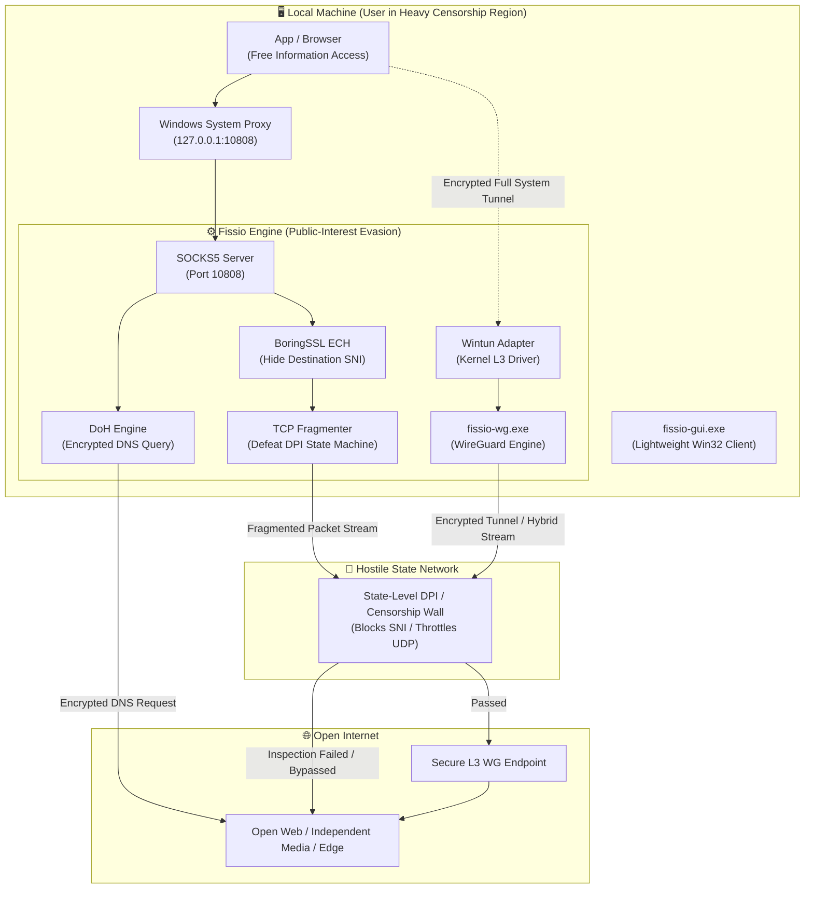

<div align="center">

```text
███████╗██╗███████╗███████╗██╗ ██████╗ 
██╔════╝██║██╔════╝██╔════╝██║██╔═══██╗
█████╗  ██║███████╗███████╗██║██║   ██║
██╔══╝  ██║╚════██║╚════██║██║██║   ██║
██║     ██║███████║███████║██║╚██████╔╝
╚═╝     ╚═╝╚══════╝╚══════╝╚═╝ ╚═════╝ 
```

# FISSIO

**A Public-Interest ECH Proxy & WireGuard® Tunnel for Free Access in High-Censorship Regions**  
*인터넷 검열이 심한 국가의 정보 접근권 보장을 위한 순수 네이티브 공익 네트워크 클라이언트*

[-0078D6?style=for-the-badge&logo=windows&logoColor=white)](https://microsoft.com/windows)
[](https://isocpp.org/)
[](https://learn.microsoft.com/windows/win32/)
[]()
[]()
[]()

[English](#-overview-english) • [한국어 설명](#-개요-korean) • [简体中文](#-项目概述-simplified-chinese) • [日本語](#-概要-japanese) • [Русский](#-описание-russian) • [Español](#-descripción-spanish) • [العربية](#-نظرة-عامة-arabic)  
[Architecture](#-architecture--mechanisms) • [Key Features](#-key-features) • [Build Guide](#-build--development) • [Legal & Trademark](#-legal--trademark-notice)

---

</div>

## 🌐 Overview (English)

**Fissio** is an open-source, public-interest Windows desktop utility engineered specifically for journalists, activists, and ordinary citizens living under **severe state-level Internet censorship, hostile DPI surveillance, and aggressive communication blackouts**.

When repressive regimes weaponize deep packet inspection, SNI filtering, and protocol throttling to isolate communities, Fissio acts as a resilient gateway to the open web. Built in pure **C++20** with **zero bloated frameworks** (No Electron, No Qt, No .NET, No Chromium), Fissio ensures reliable operation even on resource-constrained hardware in restricted zones—launching instantly with less than 15 MB of RAM and presenting an accessible native dark-mode GUI.

### 🛡️ Core Highlights
- **Human Rights & Digital Privacy**: Safeguards fundamental access to unbiased information and secure communication in heavily restricted jurisdictions.
- **Encrypted Client Hello (ECH)**: Dynamic DNS-over-HTTPS (DoH) HTTPS RR (Type 65) querying, binary ECHConfigList parsing, and BoringSSL Outer SNI encapsulation to defeat eavesdropping.
- **TCP Fragmentation Engine**: Advanced TCP segmentation (2~5 byte initial split + jitter delay) neutralizing stateful DPI surveillance machines.
- **WireGuard® Protocol L3 Tunnel**: Full-system routing through the official high-speed Wintun kernel driver (`wintun.dll`).
- **Hybrid Anti-Censorship Mode**: Couples WireGuard L3 tunneling with ECH fragmentation to pierce enterprise-grade state firewalls that block standard UDP.
- **Pure Win32 Modern Dark GUI**: Seamless border & caption unification (`#18181B`), custom owner-drawn interactive buttons, Windows 11 rounded corners, and native dark controls.
- **Zero-Friction UX**: Drag & drop `.conf` profile import, system tray minimization, auto-start on Windows boot, and one-click emergency network restoration.
- **Accessible 7-Language i18n**: Real-time hot-switching without restart for Korean, English, Simplified Chinese, Japanese, Spanish, Russian, and Arabic.

---

## 🇰🇷 개요 (Korean)

**Fissio**는 표현의 자유가 억압되고 **인터넷 검열 및 국가 단위 감청이 심한 국가의 시민, 언론인, 인권 활동가들을 위해 개발된 공익 목적의 C++20 기반 오픈소스 네트워크 도구**입니다.

권위주의 정권의 극심한 SNI 차단, 국가 차원의 능동적 DPI 패킷 감시, 해외망 및 VPN 프로토콜 강제 차단 속에서도 보편적 정보 접근권과 안전한 통신권을 보장하기 위해 설계되었습니다.

취약한 통신망이나 저사양 PC 환경에서도 원활히 동작하도록 Electron이나 .NET 같은 무거운 프레임워크를 일체 배제하고 **순수 Win32 API 및 Windows DWM 하드웨어 렌더링**만으로 제작되었습니다. 실행 파일 크기 약 1.5MB, 메모리 점유율 15MB 미만의 초경량 네이티브 구조로 위기 상황에서도 신속하고 안정적인 정보 접근을 지원합니다.

---

## 🇨🇳 项目概述 (Simplified Chinese)

**Fissio** 是一款专为**处于严苛网络审查、国家级 DPI 流量嗅探与全面通信封锁环境下的普通公民、记者和人权活动人士**打造的公益性纯原生网络工具。

当威权审查机制利用深度包检测（DPI）、SNI 阻断及主流 VPN 协议封锁来隔绝信息流通时，Fissio 成为保障基本信息获取权与安全通讯的坚固防线。项目基于纯 **C++20** 开发，**零引入冗余框架**（无 Electron、无 Qt、无 .NET、无 Chromium），内存开销低于 15 MB，即使在受限地区的低配硬件设备上亦能秒级自启并稳定穿透封锁。

---

## 🇯🇵 概要 (Japanese)

**Fissio** は、**過度な国家インターネット検閲、標的型 DPI 監視、プロトコル遮断などの情報統制下にある市民・ジャーナリスト・人権活動家**の情報アクセス権を保護するために開発された、完全ネイティブ設計の公益オープンソースツールです。

SNI 遮断やステートフル DPI パケット監視により外部との通信が途絶される環境において、自由で安全な通信経路を確保します。Electron や .NET などの重量級フレームワークを一切排除し、**純粋な C++20 および Win32/DWM API** のみで構築。実行ファイルサイズ約 1.5MB、メモリ占有量 15MB 未満の超軽量設計により、過酷な低リソース環境下でも瞬時に安定起動します。

---

## 🇷🇺 Описание (Russian)

**Fissio** — это открытый инструмент общественного назначения, созданный специально для журналистов, правозащитников и граждан, находящихся в условиях **жесткой государственной интернет-цензуры, систем тотальной слежки DPI и блокировок независимых каналов связи**.

В условиях блокировок по SNI и подавления стандартных VPN-протоколов Fissio обеспечивает надежный доступ к свободному интернету. Клиент написан на чистом **C++20** **без использования тяжелых фреймворков** (никаких Electron, Qt, .NET или Chromium). Приложение весит всего ~1.5 МБ, потребляет менее 15 МБ оперативной памяти и гарантирует быстродействие даже на слабых компьютерах в условиях нестабильной сетевой инфраструктуры.

---

## 🇪🇸 Descripción (Spanish)

**Fissio** es una herramienta de código abierto de interés público, diseñada específicamente para ciudadanos, periodistas y defensores de los derechos humanos que viven bajo **una estricta censura estatal de Internet, vigilancia activa mediante DPI y bloqueos de protocolos de comunicación**.

Frente al bloqueo sistemático de SNI y la interrupción de conexiones seguras, Fissio actúa como una vía de escape ligera y resiliente. Desarrollado en **C++20 puro sin entornos pesados** (sin Electron, Qt, .NET ni Chromium), consume menos de 15 MB de memoria RAM y cuenta con un ejecutable de apenas 1.5 MB, garantizando una disponibilidad inmediata incluso en equipos de muy bajos recursos.

---

## 🇸🇦 نظرة عامة (Arabic)

**Fissio** هي أداة برمجية مفتوحة المصدر ذات نفع عام، صُممت خصيصاً لحماية حقوق الصحفيين والنشطاء والمواطنين الذين يعيشون في ظل **رقابة حكومية مشددة على الإنترنت، ومراقبة عميقة للحزم (DPI)، وحظر متكرر لقنوات الاتصال**.

عندما توظف الأنظمة القمعية تقنيات حظر SNI والتتبع المستمر لقطع الوصول إلى الشبكة العالمية، توفر Fissio وسيلة وصول آمنة ومستقرة. تم بناء الأداة بلغة **C++20** النقية دون الاعتماد على بيئات عمل ثقيلة (بدون Electron أو Qt أو .NET)، لتستهلك أقل من 15 ميغابايت من الذاكرة (RAM) بحجم ملف لا يتعدى 1.5 ميغابايت، مما يضمن عملها بسرعة وموثوقية في أصعب الظروف.

---

## 🌟 Key Features

| 분류 | 기능 설명 | 공익 및 우회 기술 세부 특징 |
|:---|:---|:---|
| **🕊️ 공익적 자유 보장** | 디지털 기본권 보호 | 검열 국가 내 자유로운 정보 탐색 및 독립 언론·외부 소통 창구 확보 |
| **🛡️ ECH SOCKS5 Proxy** | TLS 1.3 Encrypted Client Hello | Cloudflare DoH Type 65 HTTPS RR 실시간 추출, BoringSSL ECH 주입으로 국가 검열관의 접속지 식별 원천 차단 |
| **✂️ TCP Fragmentation** | 국가 DPI 감시 패킷 무력화 | ClientHello 헤더를 2~5바이트 단위로 분할 전송하여 검열 장비의 상태 추적(Stateful Tracking) 교란 |
| **⚡ WG L3 VPN** | WireGuard® 프로토콜 호환 터널 | 커널 레벨 Wintun 드라이버 연동, 0.0.0.0/1 & 128.0.0.0/1 전체 트래픽 암호화 터널링 |
| **🧬 Hybrid Mode** | ECH + WG 복합 우회 | 국가 방화벽이 표준 UDP 포트를 전면 차단한 폐쇄망에서도 통신을 유지시키는 하이브리드 우회 모드 |
| **🎨 Modern Dark GUI** | 100% 네이티브 무결점 다크 테마 | DWMWA_CAPTION_COLOR(`#18181B`) 타이틀바 일체화, 리소스 낭비 없는 저지연 렌더링 |
| **📂 Drag & Drop** | 설정 파일 드래그 앤 드롭 | 탐색기에서 `.conf` 파일을 끌어다 놓기만 해도 즉시 검열 회피 터널 활성화 |
| **🌐 7개 언어 i18n** | 검열 피해 지역 다국어 지원 | OS 언어 자동 감지 + 한국어, 영어, 중국어, 일본어, 스페인어, 러시아어, 아랍어(RTL) 실시간 전환 |
| **🧹 Emergency Clean-up** | 원클릭 비상 라우트 복구 | 강제 네트워크 차단 또는 비정상 종료 시 남은 가상 어댑터와 시스템 프록시를 즉각 원래대로 정상화 |
| **🛡️ UAC Manifest** | 관리자 권한 자동 승격 | 복잡한 설정 없이 원클릭으로 네트워크 가상 드라이버 활성화 및 보안 권한 획득 |

---

## 📐 Architecture & Mechanisms



---

## 🌍 Supported Languages (i18n)

정보 통제 및 인터넷 검열 비중이 높은 지역의 접근성을 고려하여, Fissio는 다국어 인터페이스를 기본 탑재하고 있습니다. `GetUserDefaultUILanguage()`를 통해 시스템 언어를 자동 감지하며, 지원되지 않는 언어 환경에서는 기본값인 **English**로 작동합니다.

| Language | Code | Native Name | Status |
|:---|:---:|:---|:---:|
| **Korean** | `ko` | 한국어 | ✅ 100% |
| **English** | `en` | English | ✅ 100% (Default Fallback) |
| **Chinese (Simplified)** | `zh` | 简体中文 | ✅ 100% |
| **Japanese** | `ja` | 日本語 | ✅ 100% |
| **Spanish** | `es` | Español | ✅ 100% |
| **Russian** | `ru` | Русский | ✅ 100% |
| **Arabic** | `ar` | العربية | ✅ 100% (RTL Supported) |

---

## 🚀 Quick Start Guide

### 1. Download & Run
1. Go to the [Releases](https://github.com) section and download the latest zip archive.
2. Extract the folder anywhere (e.g. `C:\Tools\Fissio` or `D:\Fissio`).
3. Run **`fissio-gui.exe`** (or create a desktop shortcut via `scripts\create_shortcut.ps1`).

### 2. Choose Mode
- **SOCKS5 ECH Proxy Mode (Default)**:
  - Check **"Auto-configure Windows System Proxy"**.
  - Click the large **`[ START SERVICE ]`** button.
  - All web traffic from Chrome, Edge, Brave, KakaoTalk, etc., will immediately route through ECH evasion.
- **WG L3 VPN Mode**:
  - Drag and drop your `.conf` file into the Fissio window, or click **`[ Import .conf ]`**.
  - Click **`[ START SERVICE ]`** for full-system L3 kernel VPN tunneling.
- **Hybrid Mode**:
  - Combines WireGuard encapsulation with TLS ECH fragmentation for restricted network environments where UDP is filtered.

### 3. Tray & Auto-Start
- Click the close button **`[X]`** to minimize to the Windows Taskbar Notification Area (System Tray).
- Double-click the tray icon to restore the window.
- Check **"Launch automatically on Windows startup"** to protect your network on every boot.

---

## 🛠️ Build & Development

### Prerequisites
- **OS**: Windows 10 (1809+) or Windows 11 (x64)
- **Compiler**: Visual Studio 2022 / Build Tools 2026 (MSVC v143+ with C++20 support)
- **Build Tools**: CMake 3.20+ and Ninja
- **Go**: Go 1.21+ (for WireGuard tunnel engine compilation)

### Build Instructions
Clone the repository recursively to fetch all vendor submodules:

```bash
# Clone repository with submodules
git clone --recursive https://github.com/YOUR_USERNAME/fissio.git
cd fissio

# Run the automated one-click build script
build.bat
```

The compiled binaries will be output to the `build/` directory:
- `build\fissio-gui.exe` — High-DPI native Win32 dark GUI client
- `build\fissio.exe` — Standalone headless CLI client
- `build\fissio-wg.exe` — WireGuard protocol Go backend
- `build\wintun.dll` — High-speed kernel TUN driver

---

## 📁 Repository Structure

```text
fissio/
├── include/                 # C++ Header files
│   ├── advanced_config.hpp  # Config persistence (.ini)
│   ├── doh.hpp              # DNS-over-HTTPS & ECHConfigList parser
│   ├── i18n.hpp             # 7-Language localized strings
│   ├── proxy_controller.hpp # Lifecycle & process orchestration
│   ├── proxy_session.hpp    # Asio asynchronous SOCKS5 session
│   ├── socks5.hpp           # SOCKS5 protocol definitions
│   ├── system_proxy.hpp     # WinINet system proxy control
│   ├── tls_fragment.hpp     # TCP fragmentation & split logic
│   ├── wireguard_config.hpp # .conf parser & validator
│   ├── wireguard_routing.hpp# Windows IP Helper routing table control
│   └── wireguard_tunnel.hpp # Wintun / fissio-wg process bridge
├── src/                     # C++ Implementation files
│   ├── gui_main.cpp         # Modern Win32 GUI & DWM Dark Controller
│   ├── i18n.cpp             # Multi-language string tables
│   ├── main.cpp             # CLI entrypoint
│   └── *.cpp                # Core network implementations
├── scripts/                 # Utility scripts (Shortcut, Registry startup)
├── third_party/             # Upstream libraries & submodules
│   ├── asio/                # Standalone Asio (Boost-free)
│   ├── boringssl/           # Google BoringSSL with ECH support
│   ├── fissio-wg/           # WireGuard tunnel Go bridge
│   ├── wintun/              # Official Wintun driver SDK
│   ├── wireguard-go/        # Official WireGuard Go engine
│   └── wireguard-windows/   # Official WireGuard Windows components
├── CMakeLists.txt           # CMake build recipe
├── build.bat                # One-click Windows developer build script
├── sample_wireguard.conf    # Dummy configuration sample
└── README.md                # Documentation
```

---

## ⚖️ Legal & Trademark Notice

- **WireGuard®** is a registered trademark of **Jason A. Donenfeld**.  
  *Fissio is an independent third-party software project compatible with the WireGuard protocol, and is **not** affiliated with, endorsed by, or sponsored by Jason A. Donenfeld or the official WireGuard project.*
- **BoringSSL** is developed by Google and licensed under OpenSSL & ISC licenses.
- **Asio** is developed by Christopher M. Kohlhoff and licensed under the Boost Software License 1.0.
- **Wintun** is developed by Jason A. Donenfeld and licensed under the MIT License.

---

## 📄 License

This project is licensed under the **MIT License** — see the [LICENSE](LICENSE) file for details. Third-party components retain their respective open-source licenses.